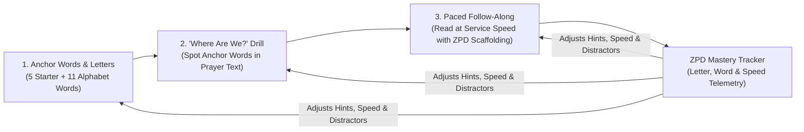

# AlefBet: Hebrew Service Reading & Follow-Along Trainer — Plan

## 1. Vision & Core Learning Loop
When attending a Hebrew service, the hardest practical skill isn't translating grammar—it is **orienting yourself in a block of Hebrew text ("Where are we?")** and **keeping pace as the reader/congregation chants ("Following along")** without getting stuck decoding a single letter while the service moves three lines ahead.

This app bridges the gap between isolated letter recognition and real-time liturgical reading using the curriculum in [Goal and Lessons.md](file:///c:/Users/ktheis/Documents/alefbet/Goal%20and%20Lessons.md) and a **Zone of Proximal Development (ZPD) Engine** that dynamically adjusts scaffolding and speed so you are always challenged just enough to grow without losing your place.



---

## 2. Curriculum & Content Architecture (from `Goal and Lessons.md`)

All content focuses on **consonant & whole-word recognition** (no vowel/*nikud* curriculum tracking yet) across the 27 letter forms (22 base + 5 *sofit* finals):

0. **Baseline Known Letters (Pre-Seeded Mastery)**
   * **א** (*Alef* — silent/glottal carrier), **ל** (*Lamed* — "l" sound), **מ** (*Mem* — "m" sound), and **ם** (*Final Mem* — "m" sound at word end).
   * These start in the **Known / Mastered** state so the ZPD engine immediately uses them as visual anchors inside the 5 starter words (e.g., spotting `א` and `ל` in **יִשְׂרָאֵל**, `מ` in **מֹשֶׁה**, and `מ...ם` framing **מִצְרַיִם**) while focusing your active learning frontier on the remaining letters in Tier 1.
   * Users can also manually toggle any letter's status on the dashboard at any time.
1. **Tier 1: The 5 Starter Anchor Words**
   * **יִשְׂרָאֵל** (*Yisra'el*), **מֹשֶׁה** (*Moshe*), **מִצְרַיִם** (*Mitzrayim*), **בָּרוּךְ** (*Barukh*), **אַתָּה** (*'Attah*)
   * With `א, ל, מ, ם` already known, Tier 1 introduces the next 10 high-frequency letters/forms (`י, שׂ, ר, ש, ה, צ, ב, ו, ך, ת`) that act as visual "landmarks" on any siddur page.
2. **Tier 2: The 11 Alphabet-Completing Words**
   * **גּוֹי** (*Goy*), **דָּבָר** (*Davar*), **זָהָב** (*Zahav*), **אֶחָד** (*'Echad*), **טוֹב** (*Tov*), **בֵּן** (*Ben*), **נֶפֶשׁ** (*Nefesh*), **כֶּסֶף** (*Kesef*), **עַם** (*'Am*), **קוֹל** (*Qol*), **אֶרֶץ** (*'Eretz*)
   * Completes the remaining base letters (`ג, ד, ז, ח, ט, נ, פ, ס, ע, ק`) and final forms (`ן, ף, ץ`).
3. **Tier 3: Liturgical Texts & Prayers (Segmented by Phrase Boundaries)**
   * **Hamotzi** (3 liturgical phrases: *Barukh attah Adonai* | *Eloheinu melekh ha'olam* | *hamotzi lechem min ha'aretz*)
   * **The Shema** (3 liturgical phrases: *Sh'ma Yisra'el* | *Adonai Eloheinu* | *Adonai Echad*)
   * **Aliyah Call-and-Response & Torah Blessing** (*Barekhu* call, Congregation response, and Reader's blessing split into natural chanting clauses)
   * Extensible JSON schema so additional prayers can be dropped in later.

---

## 3. Core Training Modes

### Mode A: "Where Are We?" — Word & Phrase Spotting
Trains your eyes to scan a full block of Hebrew right-to-left and lock onto where the reader currently is.
* **How it works:**
  1. A full prayer block (or multi-line liturgical passage) is displayed on screen in traditional Siddur typography.
  2. You hear an audio cue (Web Speech API / recorded syllable audio) **and/or** see a phonetic prompt (e.g., *"The chazzan just chanted: `...hamotzi lechem...` — tap the next word!"* or *"Find `Barukh`"*).
  3. You scan right-to-left and tap the target word in the Hebrew passage as fast as possible.
* **ZPD Adaptation:**
  * *Beginner ZPD:* Highlights the current line, shows transliteration under unintroduced letters/words, and uses your known letters (`א, ל, מ, ם`) and starter words (*Barukh*, *Yisra'el*, *Moshe*) as landmarks.
  * *Intermediate ZPD:* Full paragraph view, no line highlight; requires distinguishing look-alike consonant shapes (e.g., `ב/כ`, `ד/ר/ך`, `ם/ס`, `ו/ז/ן`).
  * *Advanced ZPD:* Continuous audio plays from a random midpoint in the prayer; you must tap the word the reader is on *while* the reading is moving.

### Mode B: Paced "Follow-Along" Reader
Trains you to keep your eyes moving right-to-left at live service speed without stalling.
* **How it works:**
  1. **Interactive Speed Dial:** A prominent, smooth **Speed Dial** control lets you adjust the reading cadence on the fly (from slow study pace up to brisk congregational chanting speed, with presets like *Slow Study*, *Gentle Chant*, and *Live Service Pace*). The ZPD engine also suggests nudging the dial up when you pass checkpoints effortlessly.
  2. **Paced Lead + Phrase-End "Catch Me" Checkpoints:** Each prayer is divided into natural liturgical phrases/clauses. As a phrase is chanted/paced, the highlight leads or fades so your eyes track the Hebrew words right-to-left, and **pauses at the end of a phrase or sentence for a "Catch Me" Checkpoint**—asking you to tap the exact word where the reader stopped (or the next word to resume) to verify you stayed with the flow.
  3. **Tap-for-Rescue:** Tapping any word at any time reveals its phonetic pronunciation and highlights its consonant breakdown, logging those consonants for extra ZPD support.
* **ZPD Scaffolding (Per-Word Consonant-Aware Rendering):**
  Instead of turning transliteration globally ON or OFF (which makes you read the English instead of the Hebrew), each word in a prayer is rendered according to your personal mastery of its consonants:
  * **Unintroduced consonants (Beyond ZPD):** Phonetic transliteration shown softly beneath the word (or over the unknown consonants) so you never stall on letters you haven't learned yet.
  * **Frontier consonants/words (Inside ZPD — ~70–85% mastery):** Hebrew word shown cleanly; known anchor letters (`א, ל, מ, ם`, etc.) and frontier letters are visually distinct, with instant hint-on-tap if you hesitate.
  * **Mastered words (Below ZPD — >90% mastery):** Pure Hebrew siddur text, no hints.

### Mode C: Letter & Anchor Word Warm-Up (Micro-Drills)
Short 60-second warm-ups targeting the specific letters or *sofit* forms that slowed you down in Modes A & B:
* **Confusable Pair Drills:** Explicitly contrasts pairs you mix up (e.g., `ב` vs `כ`, `ד` vs `ר`, `ם` vs `ס`, `שׁ` vs `שׂ`).
* **Word Decomposition:** Breaks a target word (e.g., **מִצְרַיִם**) into right-to-left letters (`ם ← י ← ר ← צ ← מ`) so you see how letters join into whole word shapes.

---

## 4. Zone of Proximal Development (ZPD) Engine

The app maintains a local learner profile (`localStorage` + exportable JSON backup) tracking three granular dimensions:

| Metric | What is Tracked | How ZPD Uses It |
| :--- | :--- | :--- |
| **Letter Mastery (27 forms + confusables)** | Recognition accuracy, response time (ms), and specific confusion matrix (e.g., tapped word with `ר` when cue had `ד`). | Introduces only 2–3 new letters into the "Active Frontier" at a time once current frontier letters reach $\ge 80\%$ accuracy at $< 1.5\text{s}$ latency. |
| **Word Recognition (Sight Vocabulary)** | Instant whole-word recognition score for the 16 target words + liturgical words (*Adonai*, *Eloheinu*, *Melekh*, *Ha'olam*). | Switches a word from letter-by-letter scaffolding to whole-word sight recognition, then removes transliteration. |
| **Following-Along Pace (WPM / SPM)** | Comfortable syllables-per-minute tracking speed without tapping "Stumbled" or missing a checkpoint. | Gradually nudges the Follow-Along pacing speed from slow study pace (~40 SPM) toward natural congregational chanting speed (~90–110 SPM). |

> [!TIP]
> **Target ZPD Sweet Spot (~80% Success Rule):** If your accuracy in a session exceeds 88%, the app automatically fades one layer of scaffolding, adds the next word from [Goal and Lessons.md](file:///c:/Users/ktheis/Documents/alefbet/Goal%20and%20Lessons.md), or increases reading speed by 10%. If you drop below 70%, it slows the pace and restores syllable/letter cues on your trouble spots.

---

## 5. Technical Stack & Project Structure

A zero-dependency, responsive Web App that runs locally in any browser (desktop, tablet, or phone) by opening `index.html` directly:

* **Architecture:** Modular Vanilla ES6+ JavaScript + HTML5 + CSS3 (no Node/npm build step required)
* **Styling:** Custom Siddur-inspired CSS (`src/styles.css`) with high-legibility Hebrew liturgical fonts (`Frank Ruhl Libre` / `David Libre` / `Noto Serif Hebrew`) displaying **clean consonant-only Hebrew (no vowel/*nikud* dots yet)** in RTL layout so you can focus purely on consonant shapes.
* **Audio:** Web Speech API (`he-IL` TTS with *Adonai* substitution for `יהוה` and phonetic fallback) + Web Audio API chimes for phrase-end checkpoints (`src/engine/audioEngine.js`).
* **Persistence:** `localStorage` persistence in `src/engine/zpdEngine.js`.

### Directory Layout
```text
alefbet/
├── Goal and Lessons.md
├── implementation_plan.md
├── index.html
└── src/
    ├── data/
    │   ├── curriculum.js       # 27 letters (א, ל, מ, ם pre-seeded), 5 starter words, 11 alphabet words, confusable pairs
    │   └── prayers.js          # Hamotzi, Shema, Aliyah blessings segmented by phrase/sentence boundaries
    ├── engine/
    │   ├── zpdEngine.js        # Consonant & word mastery, confusion matrix, scaffolding selector, frontier unlocking
    │   └── audioEngine.js      # Web Speech TTS & Web Audio cantillation/checkpoint chimes
    ├── app.js                  # Interactive views: Follow-Along, Spot the Word, Warm-Up Drills, and ZPD Dashboard
    └── styles.css              # Siddur RTL layout & ZPD color-coding styles
```

---

## 6. Implementation Phases

1. **Phase 1: Data & ZPD Engine Foundation**
   * Encode all 27 letters (with `א`, `ל`, `מ`, `ם` pre-marked as Known), 16 vocabulary words (stripped of vowel marks for clean consonant display), and 3 liturgical sections from [Goal and Lessons.md](file:///c:/Users/ktheis/Documents/alefbet/Goal%20and%20Lessons.md) segmented into natural phrases.
   * Build `zpdEngine.js` to compute per-consonant mastery, per-word mastery, confusion pairs, and dynamic scaffolding states (`unintroduced` | `frontier` | `mastered`).
2. **Phase 2: Siddur Typography & Adaptive Word Renderer**
   * Create the RTL prayer view that renders crisp, unvocalized Hebrew consonants and ZPD-driven hints so your eyes stay anchored on the letter shapes.
3. **Phase 3: "Where Are We?" Spotting Mode & Paced Follow-Along Mode**
   * Build the interactive "Find the Word/Phrase in the Prayer" drill with audio/phonetic cues and reaction-time tracking.
   * Build the Paced Follow-Along Reader featuring a live **Speed Dial**, phrase-by-phrase pacing, **phrase/sentence-end "Catch Me" checkpoints**, and one-tap "Need More Help Here" feedback.
4. **Phase 4: ZPD Progress Dashboard & Micro-Drills**
   * Build the visual Alef-Bet & Vocabulary Mastery Grid showing what is Mastered (starting with `א, ל, מ, ם`), what is in your Active ZPD Frontier, and what you need the most help with (including your top confusable letter pairs).
   * Add the 60-second ZPD Anchor Word drill.
